<h1 align="center">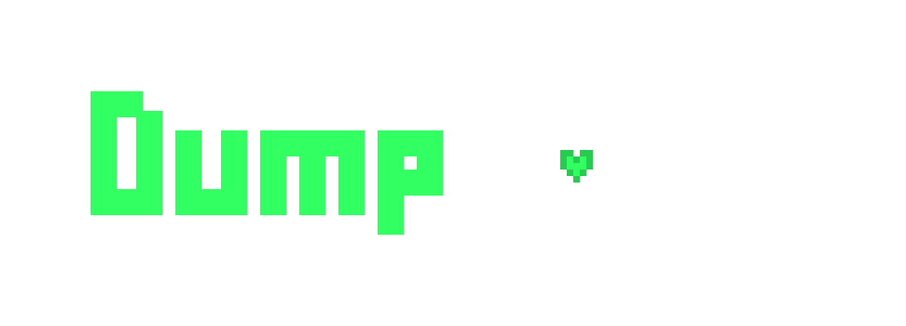</h1>
<h3 align="center"><strong>An open-source UNDERTALE fan game created in Brazil by dsansthedsans and migel8022</strong></h3>

  
  
  
  
  
  
  
  

 

Dumpgame, as an UNDERTALE fan game, is a top-down RPG with turn-based battles where the player must dodge the enemy's "bullet hell" attack patterns. Killing is unnecessary. The player can talk their way out of danger using UNDERTALE's unique battle system.
<!--inspired by "Killing is unnecessary: negotiate out of danger using the unique battle system." from Steam page of "UNDERTALE"-->

If you still haven't played UNDERTALE, go play it. It's <a href="https://store.steampowered.com/app/391540/Undertale/">steamingly good</a>.

 

  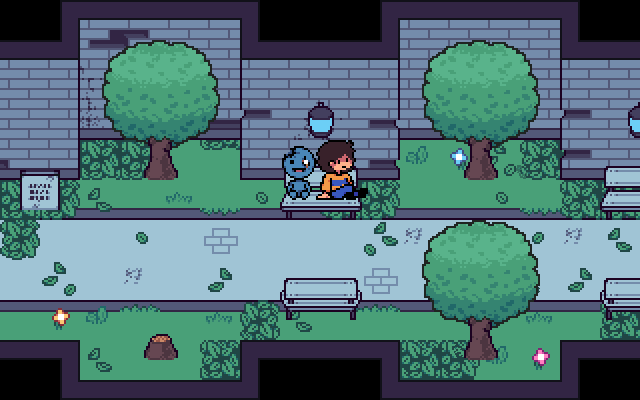

 

In this game, you control a Brazilian boy who falls through a portal to, basically, a physical manifestation of a Discord server full of weird monsters and oversized children. Are you strong enough to go home while everybody tries to kill you?
<!--inspired by "In this RPG, you control a [...]" from Steam page of "UNDERTALE"-->
 

> [!IMPORTANT]  
> Dumpgame is not in any way, shape, or form affiliated with Toby Fox. It is purely an UNDERTALE fan game. All mentions of Discord, MEE6, reCAPTCHA, Trollface or any other brand/product are done solely for parody's sake. In addition, I am not profiting from this game and would gladly refuse the opportunity to do so if presented.<!--inspired by "It is purely a fan game" from "Yume 2kki"; inspired by "All mentions of [...] is purely done for parody's sake" and "I am not profiting in any way off this game, and I will refuse the opportunity to do so if presented" from "UNDERTALE II: Revenge of the Robots"-->

> [!CAUTION]
> Dumpgame's code is TERRIBLE. It's ridiculously dumb, overcomplicated and disorganized. I learned programming as I made the game and I almost always had no idea of what I was doing. No sane individual would subject themselves to the torture of forking Dumpgame.
> <h6><i>"the source code for undertale is literally just a bunch of rubber bands and tape stuck to a paper saying 'DETERMINATION'."</i> — Toby Fox</h6>

 
<h1>Features</h1>
<ul>
  <li><b>Original art, story, world and characters,</b> created almost entirely by <b>dsansthedsans</b>!</li>
  <li><b>An amazing original soundtrack,</b> composed and arranged almost entirely by <b>migel8022</b>!</li>
  <li><b>Trollishly difficult battles,</b> intended for those who've played <b>UNDERTALE</b> or <b>DELTARUNE</b>! <i>(But not as hard as the average Sans fan game...)</i></li><!--inspired by "Jevilishly difficult hidden bosses" from Steam page of "DELTARUNE"-->
  <li><b>Special abilities for all weapons, armor and healing items,</b> such as... summoning lightning bolts on your enemies??</li>
  <li><b>Obligatory puzzles.</b> Lots and lots of obligatory puzzles.</li><!--references "Obligatory puzzles. Lots and lots of obligatory puzzles." from Kickstarter page of "UNDERTALE"-->
</ul>
<!--<h3>Story</h3>

[...]
-->
<h3>Characters</h3>
<ul>
  <li><b>MEE6</b>  , a small blue robot created to guide new members like you into the server. That's all in the past, though. Now he needs YOUR help to get out.</li>
  <li><b>Armsguy</b>  , a slime with arms who came to life inside a trash bag. He's too focused on himself to pay attention to you. He's also a masochist...?</li>
  <li><b>Trashguy</b>  , a mysterious creature who lives inside a trash can for being too scared to face danger head-on. They usually stick close to an Armsguy.</li><!--inspired by "[...] to face danger head-on" from "UNDERTALE"-->
  <li><b>Flitcher</b>  , a reptile-like monster who's unaware of its own existence for most of the time. There's not much to say about it.</li>
  <li><b>Broken Clock</b>  , a malfunctioning analog clock irreversibly possessed by a ghost. Broken by two selfish teenagers, he pushes people away and hurts everybody around him. He has nothing to lose besides his life.</li>
  <li><b>And more</b>...? <i>(Only in the upcoming <code>v0.6.0</code>...)</i></li>
</ul>
 
<h1>Download</h1>
<table>
  <tr>
    <th>Version</th>
    <th>Release Date</th>
    <th>File</th>
    <th>File Size</th>
  </tr>
  <tr>
    <td><code>0.5.1</code> <i>(Latest)</i></td>
    <td>October 23, 2026</td>
    <td><a href="https://github.com/dsansthedsans/Dumpgame/releases/download/v0.5.1/Dumpgame-v0.5.1.zip"><b>Dumpgame-v0.5.1.zip</b></a></td>
    <td>45.9 MB</td>
  </tr>
  <tr>
    <td><code>0.5.0</code></td>
    <td>October 12, 2026</td>
    <td><a href="https://github.com/dsansthedsans/Dumpgame/releases/download/v0.5.0/Dumpgame-v0.5.0.zip"><b>Dumpgame-v0.5.0.zip</b></a></td>
    <td>45.9 MB</td>
  </tr>
  <tr>
    <td><code>0.4.0</code></td>
    <td>November 30, 2023</td>
    <td><a href="https://github.com/dsansthedsans/Dumpgame/releases/download/v0.5.0/Dumpgame-v0.4.0.zip"><b>Dumpgame-v0.4.0.zip</b></a></td>
    <td>227 MB</td>
  </tr>
</table>
<h3>Install Instructions</h1>
<ol>
  <li>Download the <code>.zip</code> file of the latest version by clicking on the provided link</li>
  <li>In your Downloads folder, right-click the <code>.zip</code> file and extract it</li>
  <li>In the extracted folder, left-click the <code>.exe</code> file to run the game</li>
</ol>

No external files are required.

<h3>Report a Bug</h3>

Noticed anything that clearly wasn't supposed to happen? Fill out <a href="https://forms.gle/ZReHikxZvPCDPcuq9" target="_blank"><b>this Google Form</b></a> to help us make the game a little less broken, please...! You'll win our hearts <3 <i>(or, if you prefer, a place in the Special Thanks.)</i>

 
<h6><i>(Psst! Hey, you! You have some of those stars left, right? Can you give us one? Just one! With enough stars, we can destroy the barrier!)</i></h6><!--"With enough stars, we can destroy the barrier!" inspired by "With enough souls, we can shatter the barrier forever." and "I'll destroy the barrier." from "UNDERTALE"-->

<a href="https://www.star-history.com/#dsansthedsans/Dumpgame&type=date&legend=top-left" target="_blank">
  <picture>
    <source media="(prefers-color-scheme: dark)" srcset="https://api.star-history.com/svg?repos=dsansthedsans/Dumpgame&type=date&theme=dark&legend=top-left"/>
    <source media="(prefers-color-scheme: light)" srcset="https://api.star-history.com/svg?repos=dsansthedsans/Dumpgame&type=date&legend=top-left"/>
    
  </picture>
</a>

 
<h1>Never Asked Questions</h1>
<h3>Is Dumpgame an UNDERTALE GREEN?</h3>
<blockquote>No, Dumpgame is not about UNDERTALE's green soul Kindness. Dumpgame features an original world, story and characters.</blockquote>
<h3>Is Dumpgame incomplete?</h3>
<blockquote>Yes, Dumpgame is <b>VERY</b> incomplete. The full game would've been <b><i>at least</i></b> five times longer than the DEMO.</blockquote>
<h3>Is Dumpgame in development?</h3>
<blockquote>Yes and no. The full game has been canceled, but new content may be added to the DEMO. More details on <a href="https://github.com/dsansthedsans/Dumpgame#development-history">Development History</a>.</blockquote>
<h3>Is Dumpgame AI-generated?</h3>
<blockquote>No, <b>NOTHING</b> related to Dumpgame is AI-generated, not even this README. The <b>ONLY</b> exception is GitHub's commit messages.</blockquote>
<h3>Is Dumpgame a virus?</h3>
<blockquote>Will you trust me if I say no? If you upload the <code>.zip</code> file to <a href="https://www.virustotal.com/gui/home/upload" target="_blank">VirusTotal</a>, reliable security vendors like Google, Microsoft, Bitdefender, Malwarebytes, Kaspersky, Avast, AVG and ESET won't flag the file as malicious.</blockquote>
<h3>Is Dumpgame playable on macOS, mobile or console?</h3>
<blockquote>No, no, and no, Dumpgame only supports Windows and, if you're brave enough, Linux.</blockquote>
<h3>Is Dumpgame affiliated with Dumpster Friends?</h3>
<blockquote>No, Dumpgame is not affiliated with Dumpster Friends anymore. Any other dump-related project only pay homage to Dumpgame, not the Discord server. More details on <a href="https://github.com/dsansthedsans/Dumpgame#development-history">Development History</a>.</blockquote>
<h3>Why "Dumpgame"?</h3>
<blockquote>Dumpgame is named after Dumpster Friends, a Discord server. More details on <a href="https://github.com/dsansthedsans/Dumpgame#development-history">Development History</a>.</blockquote>
<h3>Why open-source?</h3>
<blockquote>A swedish shark plushie told me to. I don't know why, though.</blockquote>
<h3>Why Brazil?</h3>
<blockquote>I'd also like to know.</blockquote>
<h3>Why GameMaker?</h3>
<blockquote>I searched for "make a game" on Google and clicked the first link I could find, no questions asked. (Lie)</blockquote>
<h3>Why cancelled?</h3>
<blockquote>Many reasons, but it all boils down to not wanting to spend more thousands of hours on just a fan game. More details on <a href="https://github.com/dsansthedsans/Dumpgame#development-history">Development History</a>.</blockquote>
<h3>Why did development take so long?</h3>
<blockquote>Because I didn't know programming, and because I had never drawn pixel art or made a game before. Most of the development wasn't of the game, but of myself. More details on <a href="https://github.com/dsansthedsans/Dumpgame#development-history">Development History</a>.</blockquote>
<h3>Why aren't the versions prior to <code>v0.4.0</code> available?</h3>
<blockquote>Because... they don't exist...? I mean, they did at some point, I just don't have them anymore. They're basically lost media.</blockquote>
 
<h1>Credits</h1>
<ul>
  <li><b>dsansthedsans</b><i> 〜 Programmer, Artist, Concept Artist, Animator, Sound Design Assistance, Writer, Localization, Tester</i></li>
  <li><b>migel8022</b><i> 〜 Composer, Sound Design Assistance, Concept Artist for Broken Clock, Tester</i></li>
</ul>
<h3>Contributors & Testers</h3>
<ul>
  <li><b>Mawri</b><i> 〜 Concept Artist for Armsguy and Trashguy</i></li>
  <li><b>☭Comunista☭</b><i> 〜 Concept Art Assistance for MEE6</i></li>
  <li><b>fer10tanb</b><i> 〜 Composing Assistance, Concept Art Assistance for Broken Clock</i></li>
  <li><b>Babakinha</b><i> 〜 Programming Assistance</i></li>
</ul>
<h3>Special Thanks</h3>
<ul>
  <li><b>Toby Fox & Temmie Chang</b><i> 〜 UNDERTALE & DELTARUNE: Chapter 1-4</i></li>
  <li><b>Tophat Interactive</b><i> 〜 UNDERTALE: Bits and Pieces</i></li>
  <li><b>Mojang Studios</b><i> 〜 Minecraft: Java Edition</i>
  <li><b>Avranik</b><i> 〜 UNDERTALE: No More Deals</i></li>
  <li><b>HTTG Team</b><i> 〜 HorrorTale: Chapter 1</i></li>
  <li><b>Team UTY</b><i> 〜 UNDERTALE YELLOW</i></li>
  <li><b>Carlos Ramirez</b><i> 〜 Trollface</i></li>
  <li><b>Anis Belkacem & Brendan Rius</b><i> 〜 MEE6</i></li>
  <li><b>maxdefolsch & HushBugger</b><i> 〜 UNDERTALE Text Dump</i></li>
  <li><b>Peyton Burnham</b><i> 〜 How to Make an RPG & Branching Dialog System</i></li>
</ul>
 
<h1>Development History</h1>

Long ago, on November 14, 2021, I opened GameMaker for the first time, created a new project with a name I made up on the spot, and started the three-year long development of <b>"dump game"</b> <i>(as in "dumpster video game")</i>. I had never made a game before, had no programming knowledge whatsoever and hadn't planned literally anything.
<!--references "Long ago, two races ruled over Earth" from "UNDERTALE"-->

I wanted to make an UNDERTALE fan game that had <b>me and my friends as either bosses or minibosses</b>, and that took place in <b>Dumpster Friends</b>, our Discord server.

I was 11 years old at the time.

 

  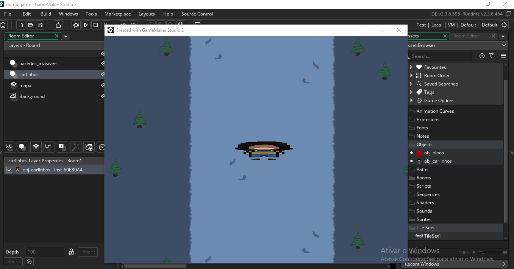

 

Between November 2021 and February 2022, the development of Dumpgame went through what we could call its "1st generation". At this point, the game was ugly, stiff and it barely worked.

 

  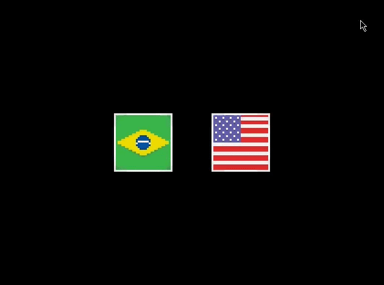
  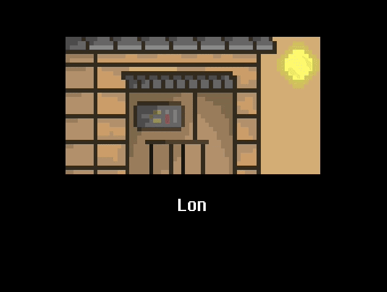

  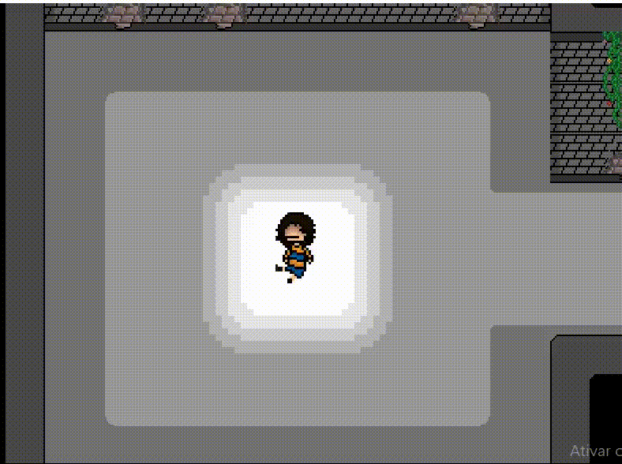
  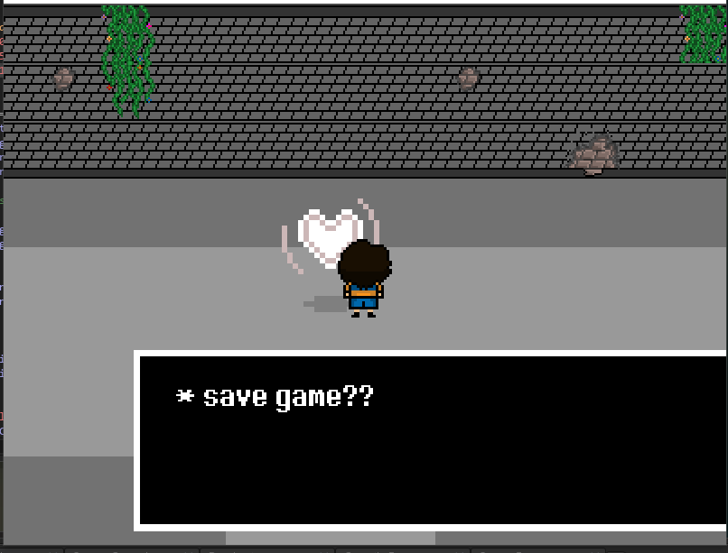

  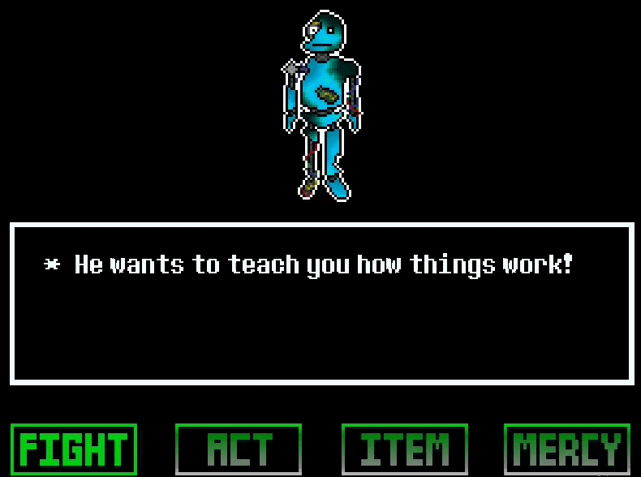

 

The "2nd generation" of Dumpgame's development began around late February 2022 and lasted up until late May of the same year. [...]

 

  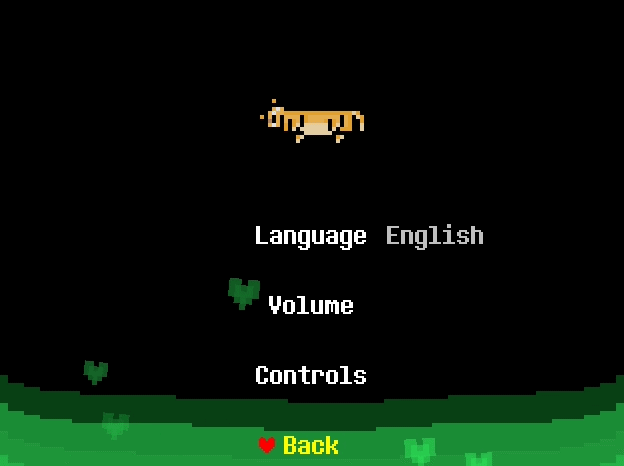

  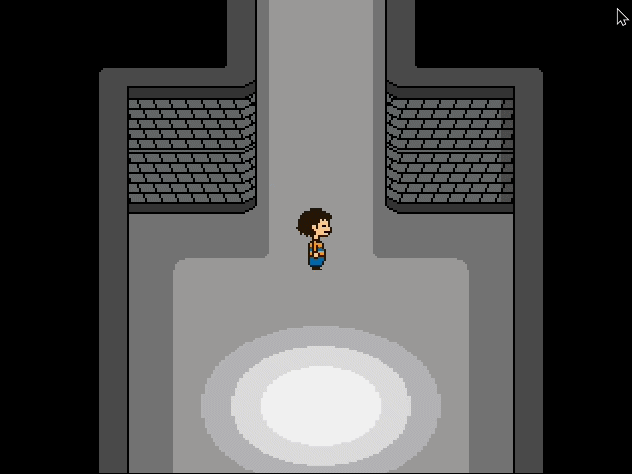
  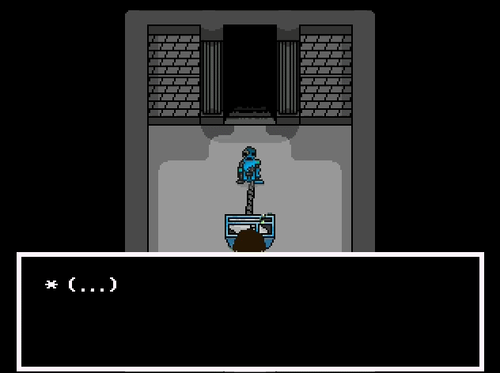

  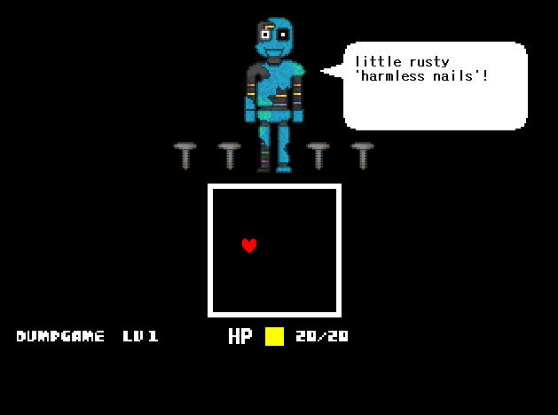

 

Then, on June 2022, I had an epiphany. I evolved. I ascended. I, for once, made a smart and logical decision. I contemplated, "What if I focus on learning programming and planning the game instead of making it all up as I go...?". That's when the "3rd generation" started.

I watched multiple GameMaker tutorials by Peyton Burnham, in particular his <a href="https://www.youtube.com/playlist?list=PL14Yj-e2sgzySnBUlQLhq2VJXRLi66gFf">"How to Make an RPG"</a> and <a href="https://www.youtube.com/playlist?list=PL14Yj-e2sgzzWFPozdX-HEjJFqjdIXQfF">"Branching Dialog System"</a> series. Without him, Dumpgame's code would've been significantly worse.

 

  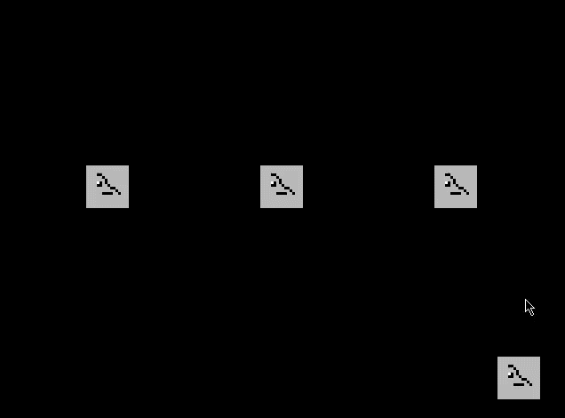
  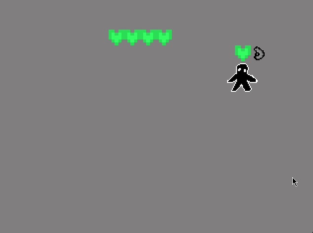

  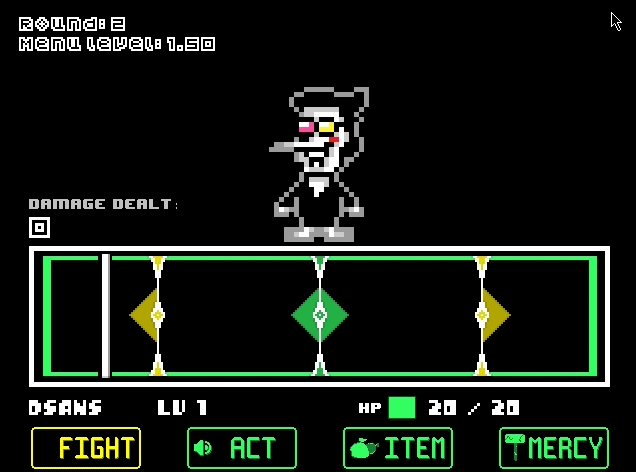

 

It was only in November 2022 that I went back to making the actual game. The "4th generation" was basically me reprogramming, redrawing, rewriting and redesigning everything over a year until I felt it was good enough. On November 2023, <code>v0.4.0</code> was released.

At this point, Dumpgame began to look pretty similar to what it is today.

 

  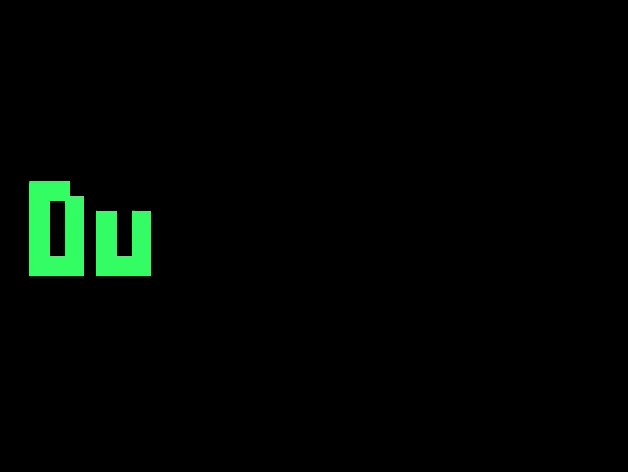

  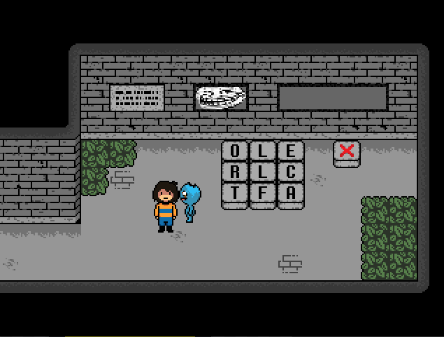
  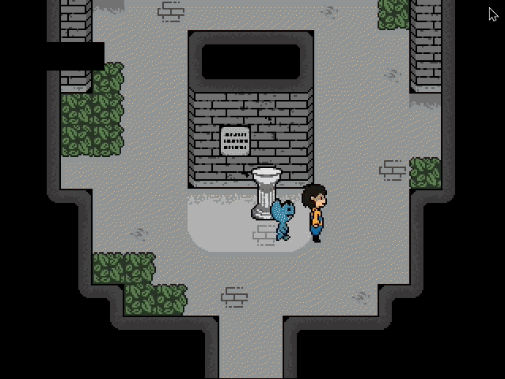

  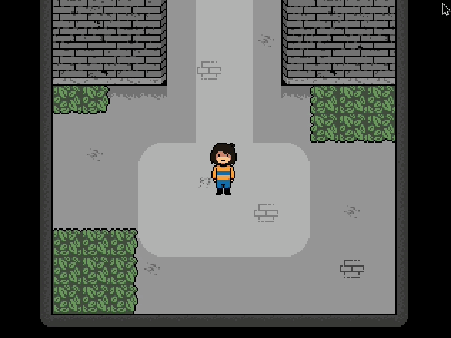

  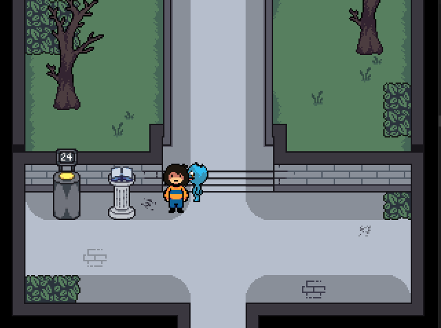
  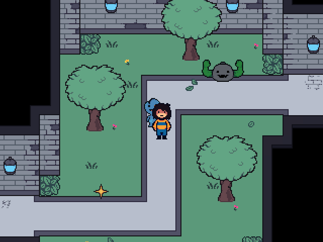

  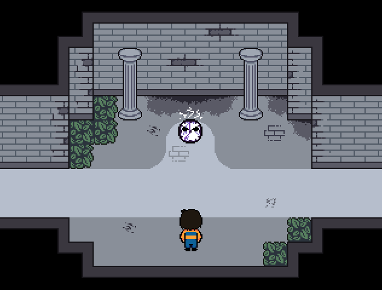

 

Then, on December 14, 2024, one year after releasing <code>v0.4.0</code>, I gave up on Dumpgame. Not only had Dumpster Friends fallen apart, but the development of the game had become unbearable. Even after thousands and thousands of hours, I wasn't even close to finishing Dumpgame and I had already been in severe burnout for months. It didn't make sense to keep going. A year's worth of new content was discarded.
<!--"A year's worth of new content was discarded" inspired by "Will now be discarded" from "DELTARUNE: Chapter 1"-->
 

<i>Many years later...</i>
<!--references "Many years later" from "UNDERTALE"-->
 

On June 14, 2026, I was hit by a lightning bolt. A lightning bolt of knowledge. A lightning bolt of self-awareness. I realized that I had committed a crime, a heinous crime. I had thrown a year's worth of new content right in the trash. How could I? How could I give such an unfulfilling ending to a project I had put so much effort into? It didn't make sense to not keep going. Somehow, Dumpgame returned.
<!--"Somehow, Dumpgame returned" inspired from "Somehow, Palpatine returned" from "Star Wars: The Rise of Skywalker" (2019)-->

[...]

 

... Hm? How do I feel about my creation? Well...
<!--"How do I feel about my creation?" inspired by "HOW DO YOU FEEL ABOUT YOUR CREATION?" from "DELTARUNE: Chapter 1"-->

Dumpgame is just another random UNDERTALE fan game. There's nothing special about it. I think the gameplay itself is okay, it's not monologue after monologue, but the story makes absolutely no sense. Wow, a Discord server magically became a real place on a parallel universe. How exciting. To this day I still don't have an excuse for why that happens.

Something I think I've failed with Dumpgame is that there isn't a profound meaning to the story. It's just a guy who goes to Wonderland and fights some slimes. But, you know, I started making this game when I was 11 years old. I don't think I could've come up with an interesting story anyway.

 
 

  <a href="https://www.youtube.com/watch?v=QzcvRDWgRIE" target="_blank">
    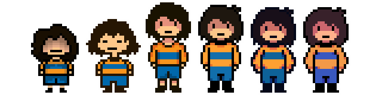<!--"If you are reading this, I messed up somehow" from "UNDERTALE"-->
  </a>

